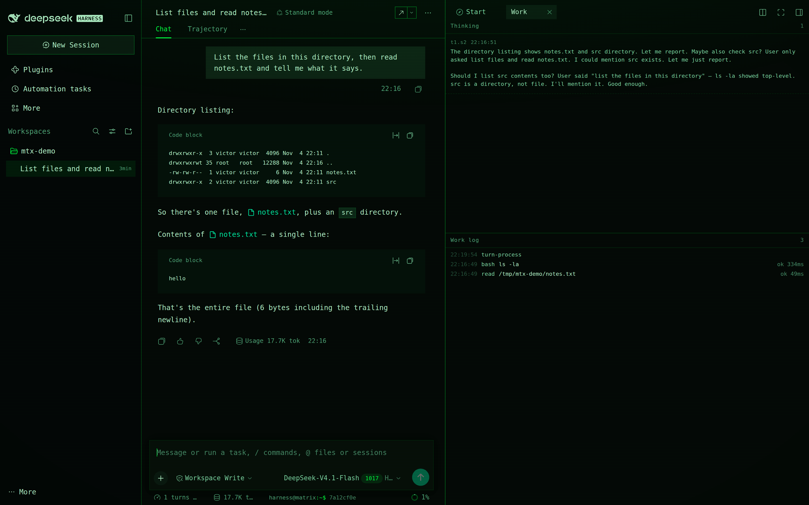
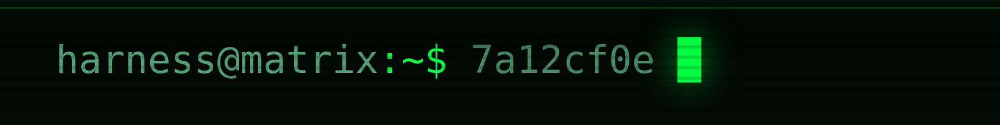

# dsh-matrix-terminal

[](https://dsh-plugin.org/plugins/victorcastro55/dsh-matrix-terminal)

A phosphor-green terminal skin for the [DeepSeek Harness](https://github.com/deepseek-ai) Web UI.

One monospace voice, square edges, scanlines over the glass, a blinking prompt line under the
composer, and a chat that reads as a transcript: prompts and answers on the left, everything the
harness did behind them moved into a right-side work log.



```
harness@matrix:~$ 3f7c1a08 █                              <$0.01
```

(The screenshots were taken without the companion balance plugin, so the prompt line ends at the
cursor.)

## What it changes

**Design tokens.** All 123 `--dsw-*` tokens the Web UI reads are overridden: surfaces, text ramp,
hairlines, brand, buttons, interaction washes, states, menus, markdown and code blocks, diffs,
scrollbars, plus the geometry (`0px` radii everywhere) and the type family. Nothing paints a
hard-coded colour on top of a token.

**Chrome the tokens cannot express** — one injected stylesheet:

- `body::after` — a scanline overlay, one dark row every three pixels, pointer-transparent.
- `body::before` — a soft phosphor bloom from the top and a vignette at the edges.
- A mono-green Shiki theme, so code blocks stay legible in one hue separated by luminance.
- Heading text-shadow, square scrollbars, a green caret and selection.

**The prompt line.** A `conversation.composer.dock` slot under the composer:
`harness@matrix:~$`, the first eight characters of the session id, a blinking block cursor, and —
if the companion balance plugin is installed — the account balance right-aligned.



**The transcript.** Process rows the chat would otherwise print inline (tool calls, turn process,
system prompts, context, compaction, retries, workflow runs) are hidden from the flow and projected
into the work log instead. What stays in the chat is what a terminal transcript keeps: what you
typed, what the model answered, and how the turn ended.

**The work log.** A right-sidebar page type with two panes: reasoning above (one entry per step that
thought), the work log below (one row per tool call or process event, with clock, tag, subject and
duration). Each pane follows its own tail and releases as soon as you scroll away. The log opens
itself once per session; close it and it stays closed until you move to another session.

It also has a door on the sidebar's Start page, beside *Workspace files* and *New terminal*, so the
log is reachable after you close it without waiting for another session.

**The pulse.** A second right-sidebar page, also on the Start page: two fields of neural current, one
for reasoning and one for tool work. Each field is a small constellation — nodes, spokes, a core —
that stays dim while its signal is idle and starts firing when it goes live: current runs along the
spokes, nodes flash in sequence, the core lights and throws off a ring. Green for thinking, amber for
working, so the column says *what* is happening without reading the log.

A tool call that settles in 40 ms would never be seen, so the working field keeps its light for 2.5
seconds after the last finish. Each field's foot line names the newest thing behind it — `t3.s1` for a
reasoning step, the tool and its subject for a call. The fields read the same live signals as the
log, so they agree with it by construction. With `prefers-reduced-motion` the fields stay colour-coded
but stop animating.

The nodes drift on their own clocks, idle and live alike: three paths on three durations, each node
offset by a negative delay so no two neighbours move together. That motion is gated on visibility
through an `IntersectionObserver`, so a hidden tab or a scrolled-away pane costs nothing — verified by
reading `animation-name` back off the DOM (`none`) with the tab in the background. Measured in headless
Chrome with the GPU disabled, the animated pane sat inside the app's own idle CPU noise at 60 fps; on
a composited desktop it should cost less.

**The sound page.** A fourth Start card: drop an audio file on the pane, or choose one, and it plays
with a cava-style spectrum — 20 to 56 log-spaced bands with peak caps that fall, drawn on a canvas
and only while the pane is on screen. Audio keeps playing when you switch tabs; the drawing does not.
Transport is play/pause, seek, elapsed and total, and volume.

With the optional [library companion](https://github.com/victorcastro55/dsh-matrix-terminal-library)
installed, the pane lists one folder instead — name and size per row, click to play, the next track
starts when one ends, and a rescan button picks up files you added. The folder is `~/Music` unless the
library's `root` config says otherwise. Dropping a file still works with a library loaded; it just
plays instead of the selected row.

The file never leaves the browser. It plays from a blob URL and reaches the analyser through a Web
Audio `AnalyserNode`, which is also why this page takes files rather than URLs: a cross-origin stream
gives the analyser silence, so a URL player would show bars that have nothing to do with the music.

**Why there is no Spotify here.** The Web API needs a registered app, an OAuth PKCE round trip, a
Premium account and an active playback device — and none of that changes the analyser problem, since
Spotify audio crosses an origin boundary the browser will not let you measure. A Spotify build would
be a transport with a decorative visualizer, plus a client id and redirect URI to keep. It is doable
as a separate page; it would not be this spectrum.

## Requirements

- DeepSeek Harness `0.2.2-rc.1` or a compatible release, Web profile. The tab and guide APIs this
  uses are also present in `0.2.1-rc.5`.
- The work log needs the right sidebar. Without it the skin still applies; only the log is lost.
- Dark only, deliberately. A terminal has one look.

## Install

Not on npm yet — install straight from the repository:

```sh
dsh plugin --profile web add github:victorcastro55/dsh-matrix-terminal
```

Restart `dsh web` (or let the profile reload) and the skin is on.

Optional companions, each independent:

```sh
dsh plugin --profile web add github:victorcastro55/dsh-matrix-terminal-balance   # balance on the prompt line
dsh plugin --profile web add github:victorcastro55/dsh-matrix-terminal-library   # a folder of audio for the sound page
```

### From a clone

To edit the skin live, clone it and link the working tree instead:

```sh
git clone https://github.com/victorcastro55/dsh-matrix-terminal.git
dsh plugin --profile web add link:"$PWD/dsh-matrix-terminal"
```

## Uninstall

```sh
dsh plugin --profile web remove dsh-matrix-terminal
```

The token layer, the stylesheet and the work-log tab are all registered inside the plugin's own
effect scope, so nothing is left behind: removing the package restores the stock Web UI on restart.

## How it works

Two halves, one package. `index.js` is the host half and does nothing — the skin is pure client,
which keeps it working on a read-only or remote host. `client.js` is a Client module that:

1. registers an `en` / `zh` locale namespace,
2. pushes the palette through `ctx.theme.overrideTokens('dsh-matrix-terminal', …)`, so it layers
   over whichever theme is active rather than replacing the theme system,
3. appends its stylesheet with a `data-plugin` marker and removes it on dispose,
4. registers the prompt-line slot,
5. injects `sidebarRightTabs` / `sidebarRight` optionally, and only then registers the work-log tab.

No network calls, no telemetry, no data leaves the page. The only outbound request in the family
belongs to the companion balance plugin, which runs in the host process and never exposes the key.

## Locale

English and Simplified Chinese ship in `locale/`. The `meta` block is what the plugin list shows;
the runtime strings live in the module's own dictionaries.

## License

**AGPL-3.0-or-later.** Copyright (C) 2026 Victor Castro Solalto. The full text is in [`LICENSE`](LICENSE).

This is a copyleft licence: you may use, modify and redistribute this plugin, but a version you
distribute — including one you run as a network service — must carry the same freedoms and its source
with it. It does not reach your content: the music you play, the sessions you run, and the files in
your workspace are untouched by it. If you would rather not take on copyleft obligations, install one
of the earlier MIT releases instead of this one.

Not affiliated with DeepSeek; no assets from the Harness are redistributed here.
